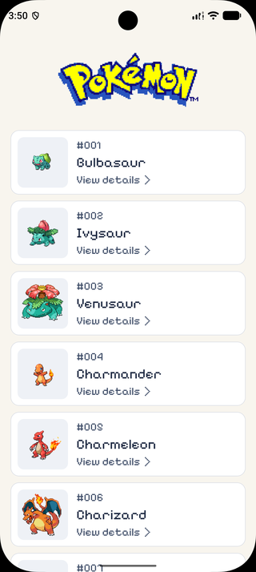
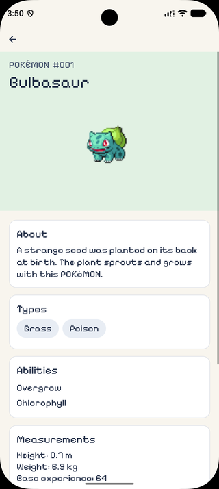
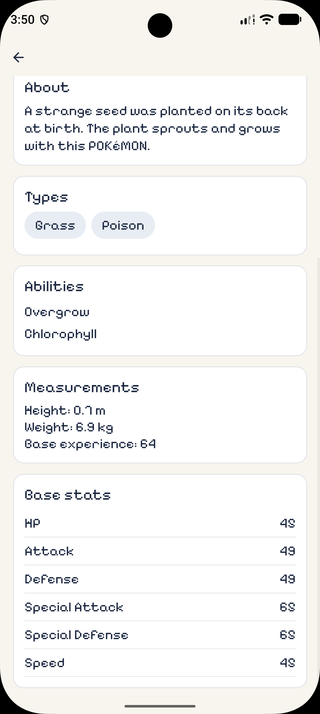
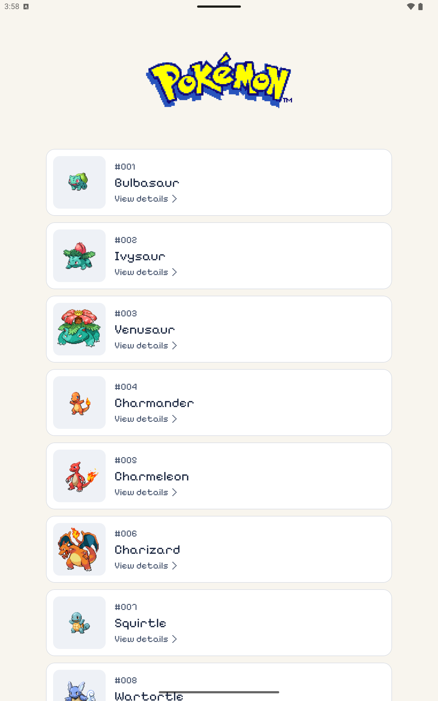
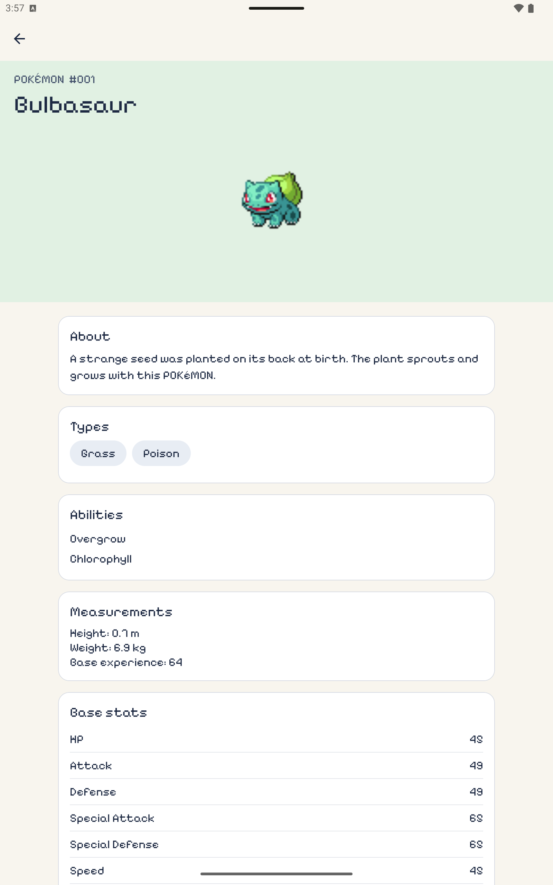

# React native pokeapi

Aplicación móvil desarrollada con Expo y React Native que consulta [PokéAPI](https://pokeapi.co/). Presenta un listado paginado de Pokémon y una pantalla de detalle con imagen, tipos, habilidades, estadísticas, altura y peso.

## Capturas y demostración

Evidencia capturada en emuladores Android de teléfono y tablet, ambos en orientación vertical.

### Teléfono Android

| Listado de Pokémon                                                           | Detalle del Pokémon                                                                               | Medidas y estadísticas                                                          |
| ---------------------------------------------------------------------------- | ------------------------------------------------------------------------------------------------- | ------------------------------------------------------------------------------- |
|  |  |  |

[Ver o descargar el video de demostración](docs/videos/pokedex-demo.mp4). Muestra la navegación al detalle, la consulta de estadísticas, el regreso al listado y el desplazamiento hasta Pokémon de la segunda página, incluido Pikachu.

### Tablet Android: Pixel Tablet en vertical

Las capturas de 1600 × 2560 muestran cómo el listado y las secciones de información mantienen un ancho limitado y centrado en una pantalla más grande, con más contenido visible que en el teléfono.

| Listado en tablet                                                                   | Detalle y estadísticas en tablet                                                                       |
| ----------------------------------------------------------------------------------- | ------------------------------------------------------------------------------------------------------ |
|  |  |

[Ver o descargar el video de la tablet en vertical](docs/videos/pokedex-tablet-demo.mp4). Muestra la navegación al detalle y el desplazamiento por el listado en una pantalla de mayor tamaño.

## Requisitos

- Node.js compatible con Expo SDK 58 y React Native 0.88: Node 22.13 o posterior dentro de la rama 22, o Node 24.3 o posterior dentro de la rama 24.
- npm y acceso a internet para instalar dependencias y consultar PokéAPI por primera vez.
- Para Android local: Android Studio, Android SDK y un emulador configurado o un dispositivo Android conectado.
- Para iOS local: una Mac con Xcode y un simulador o dispositivo configurado.

Las dependencias nativas de la aplicación requieren una compilación de desarrollo; Expo Go no incluye todos los módulos utilizados.

## Instalación y ejecución

Instala las dependencias desde la raíz del proyecto:

```bash
npm ci
```

Antes de la primera compilación, ejecuta un prebuild limpio para la plataforma correspondiente. Este paso aplica la configuración de `app.json` y los plugins nativos, incluido el ajuste de CMake para Android.

Para Android, con un emulador iniciado o un dispositivo conectado:

```bash
npx expo prebuild --clean --platform android
npx expo run:android
```

Para iOS, desde una Mac con Xcode configurado:

```bash
npx expo prebuild --clean --platform ios
npx expo run:ios
```

`prebuild --clean` elimina y regenera el directorio nativo de la plataforma elegida (`android/` o `ios/`). Los ajustes nativos deben mantenerse en `app.json` y los config plugins, ya que las modificaciones manuales de los archivos generados se perderán. Repite el prebuild y la compilación cuando cambien las dependencias nativas o su configuración; los cambios habituales de JavaScript o TypeScript no requieren regenerar el proyecto nativo.

Los comandos `run:android` y `run:ios` compilan e instalan la aplicación e inician Metro. Para iniciar Metro por separado, después de instalar la compilación de desarrollo:

```bash
npx expo start
```

El script `npm start` también limpia la caché de Metro, pero requiere que `watchman` esté instalado y disponible en el PATH.

## Arquitectura

El proyecto utiliza una **arquitectura modular por funcionalidades (feature-based o feature-first), con Clean Architecture dentro de cada feature**. Cada funcionalidad agrupa su dominio, acceso a datos y presentación, manteniendo separadas sus responsabilidades.

El código de la funcionalidad vive en `src/features/pokemon` y se organiza en tres capas:

- **Dominio:** modelos de la aplicación, contrato del repositorio y casos de uso para lista, detalle y especie.
- **Datos:** cliente de PokéAPI, tipos de los campos consumidos e implementación del repositorio. El repositorio transforma las respuestas de la API a modelos de dominio.
- **Presentación:** pantallas, hooks y componentes para el listado y el detalle. React Query coordina el estado de las consultas.

Las rutas de Expo Router están en `src/app`. Los casos de uso reciben el repositorio como dependencia; la implementación concreta se conecta desde los hooks.

Los providers globales viven en `src/providers`: componen los contextos de gestos, áreas seguras, consultas e inicialización de la aplicación. La persistencia de TanStack Query se configura en `src/lib/query-cache.ts`, con un adaptador de MMKV independiente del feature de Pokémon. El provider administra una caché compartida; los hooks de cada funcionalidad definen sus propias claves y consultas.

## Persistencia y funcionamiento offline

TanStack Query mantiene los resultados en caché y su proveedor de persistencia los guarda mediante un adaptador de MMKV. El proyecto configura `staleTime: 0` para poder actualizar los datos al volver a consultar, y `gcTime` y `maxAge` de siete días para conservar la caché inactiva y restaurar la copia persistida. Se muestra primero la información disponible y la actualización ocurre en segundo plano; si falla, se conservan los datos guardados. La antigüedad de `maxAge` se calcula sobre la copia persistida del cliente, no de forma independiente por Pokémon.

El funcionamiento offline de la caché fue revisado durante el desarrollo. La disponibilidad depende de los datos que se hayan consultado y conservado previamente; un Pokémon no consultado puede necesitar conexión. Las imágenes se gestionan por separado, por lo que no se garantiza que todas estén disponibles offline.

## Optimizaciones de rendimiento

- **Memoización automática:** React Compiler está habilitado mediante `experiments.reactCompiler` en `app.json`. Optimiza los componentes y hooks compatibles, reduciendo la necesidad de añadir `React.memo`, `useMemo` o `useCallback` manualmente.
- **Virtualización y paginación:** `FlatList` mantiene una ventana de elementos alrededor del área visible, en lugar de montar todo el listado. Los datos se solicitan en páginas de 20 Pokémon; la siguiente página se carga al acercarse al final, evitando solicitudes simultáneas de paginación mientras hay una consulta en curso.
- **Reutilización de las celdas:** cada Pokémon utiliza su nombre como clave estable. Al unir las páginas con `flatMap`, se crea un arreglo nuevo pero se conservan las referencias de los elementos anteriores. La prop `strictMode` de `FlatList` estabiliza su renderizador interno y permite omitir renders de celdas cuyas props no han cambiado.
- **Caché compartida y persistente:** TanStack Query reutiliza los datos de cada Pokémon entre su tarjeta y la pantalla de detalle mediante la misma clave `['pokemon-detail', name]`. MMKV permite restaurar las consultas guardadas al abrir la aplicación. Con `staleTime: 0`, los datos de caché se mantienen disponibles mientras se intenta actualizarlos en segundo plano.
- **Caché de imágenes:** las imágenes se muestran con `expo-image`, cuya política predeterminada utiliza caché en disco para reutilizar imágenes ya descargadas.
- **Skeletons de carga:** el listado y el detalle muestran placeholders cuando todavía no hay datos disponibles; las tarjetas mantienen el nombre y reservan el espacio de la imagen mientras se consulta su información. Se utiliza `animate-pulse` de NativeWind, ejecutado mediante Reanimated, para animar solo la opacidad. El listado y el detalle animan un contenedor común en lugar de cada bloque por separado. La variante `reduce-motion:animate-none`, definida en `tailwind.config.js` para compatibilidad con NativeWind 4, desactiva el pulso cuando el dispositivo solicita reducir movimiento. Las actualizaciones de datos en caché y la paginación mantienen visible el contenido existente.

## Linting y formateo de código

El proyecto utiliza ESLint para detectar problemas de código y Prettier para mantener un formato consistente.

### Formato automático en VS Code

La configuración de `.vscode/settings.json` selecciona la extensión **Prettier - Code formatter** (`esbenp.prettier-vscode`) como formateador predeterminado y habilita `editor.formatOnSave`. Con esta extensión instalada, guardar con **Ctrl + S** aplica las reglas de `.prettierrc`:

| Regla           | Valor    | Comportamiento                                                                                   |
| --------------- | -------- | ------------------------------------------------------------------------------------------------ |
| `singleQuote`   | `true`   | Prefiere comillas simples en las cadenas de JavaScript y TypeScript.                             |
| `semi`          | `true`   | Añade punto y coma al final de las sentencias.                                                   |
| `printWidth`    | `150`    | Utiliza 150 caracteres como ancho objetivo para distribuir las líneas; no es un límite estricto. |
| `trailingComma` | `"none"` | Omite las comas finales.                                                                         |
| `tabWidth`      | `4`      | Usa una indentación de cuatro espacios.                                                          |
| `useTabs`       | `false`  | Utiliza espacios en lugar de tabulaciones para indentar.                                         |

VS Code también configura cuatro espacios para archivos TypeScript y TSX y desactiva la detección automática de indentación. Al guardar explícitamente solicita correcciones de código, correcciones de ESLint, organización de imports y ordenación de miembros; estas acciones dependen de que las extensiones correspondientes las proporcionen. Para las correcciones de ESLint se necesita la extensión **ESLint** (`dbaeumer.vscode-eslint`).

### Reglas de linting

`eslint.config.js` extiende `eslint-config-expo/flat`, que aporta las reglas de Expo para el proyecto, incluidas las comprobaciones de React y sus hooks. La configuración local reconoce `__dirname` como variable de solo lectura en las pruebas CommonJS de `src/**/__tests__/*.cjs` y excluye `dist/*` y `.expo/**`.

Las verificaciones se pueden ejecutar desde la raíz del proyecto:

```bash
npm run lint
npx tsc --noEmit
```

El primer comando ejecuta ESLint mediante Expo; el segundo comprueba los tipos de TypeScript sin generar archivos.

## Estado de plataformas

La aplicación se desarrolló y revisó en Android. **iOS no se ha ejecutado ni validado**, porque durante el desarrollo no se contó con una Mac. Queda pendiente comprobar compilación, interfaz, accesibilidad y persistencia en iOS.

## Librerías y herramientas principales

- **TanStack Query (`@tanstack/react-query`):** coordina las consultas a PokéAPI mediante funciones proporcionadas por la aplicación. Administra sus estados de carga y error, reintentos, paginación y caché en memoria; no realiza las peticiones HTTP por sí solo.
- **Persistencia de TanStack Query (`@tanstack/react-query-persist-client` y `@tanstack/query-async-storage-persister`):** guarda y restaura la caché de consultas mediante un adaptador de almacenamiento. En este proyecto el adaptador utiliza MMKV, lo que permite recuperar datos previamente consultados cuando siguen disponibles en la caché. La disponibilidad offline de imágenes y datos no consultados no está garantizada.
- **MMKV (`react-native-mmkv`):** almacena localmente los datos de caché como pares clave-valor. Usa acceso nativo síncrono mediante Nitro Modules; su proyecto publica comparativas favorables frente a otras opciones de almacenamiento, pero este proyecto no ha medido esa diferencia. [Documentación y benchmark de MMKV](https://github.com/margelo/react-native-mmkv).
- **Nitro Fetch (`react-native-nitro-fetch`):** realiza las peticiones HTTP a PokéAPI mediante una API similar a `fetch`, apoyada en módulos nativos. Sus autores publican pruebas donde una petición normal fue aproximadamente entre un 15 % y un 25 % más rápida que `fetch` incorporado, en las condiciones descritas en su benchmark. La mejora depende del dispositivo, la red y el servidor; no se ha medido en esta aplicación. La biblioteca también admite precarga, pero la app no la tiene configurada. [Benchmark de Nitro Fetch](https://github.com/margelo/react-native-nitro-fetch#benchmarks).
- **Nitro Modules (`react-native-nitro-modules`):** proporciona la infraestructura nativa que utilizan MMKV y Nitro Fetch para comunicarse con JavaScript.
- **NativeWind y Tailwind CSS (`nativewind` y `tailwindcss`):** permiten aplicar clases de utilidades de Tailwind a componentes de React Native, facilitando la construcción y consistencia de los estilos.
- **Feather (`@react-native-vector-icons/feather`):** proporciona iconos, como el indicador que se muestra cuando una imagen de Pokémon no está disponible.
- **Expo Image (`expo-image`):** muestra las imágenes de Pokémon y el logotipo, con opciones de ajuste y gestión de imágenes.
- **Expo Font (`expo-font`):** incorpora y carga la fuente Pixelify Sans utilizada en la interfaz.
- **Expo Splash Screen (`expo-splash-screen`):** controla la pantalla inicial mientras se carga la fuente.
- **React Native Reanimated y Worklets (`react-native-reanimated` y `react-native-worklets`):** aportan la infraestructura de animaciones y ejecución requerida por las dependencias de interfaz.

## Fix de compilación de Android en Windows

Para resolver el error `Filename longer than 260 characters` causado por rutas largas durante la compilación nativa de Android en Windows, el proyecto utiliza `expo-build-properties` con CMake `3.31.6`.

La configuración se encuentra en `expo.plugins` dentro de `app.json`:

```json
[
    "expo-build-properties",
    {
        "android": {
            "cmakeVersion": "3.31.6"
        }
    }
]
```

El plugin aplica esta versión de CMake al generar el proyecto nativo de Android, sin editar manualmente los archivos generados en `android/`.

## Pruebas

Con las dependencias instaladas, ejecuta `npm test` para correr las pruebas unitarias mediante el ejecutor integrado de Node.js (una versión de Node compatible con Expo indicada arriba). Las pruebas usan respuestas simuladas y no necesitan conexión a PokéAPI ni un emulador.

## Pendientes y mejoras futuras

- **Validación de iOS:** comprobar compilación, interfaz, navegación, accesibilidad y persistencia en iOS. Esta plataforma no se ha ejecutado durante el desarrollo por no disponer de una Mac.
- **Integración continua y pruebas E2E:** automatizar lint, TypeScript y las pruebas existentes en GitHub Actions, utilizando [Fastlane](https://docs.fastlane.tools/best-practices/continuous-integration/) para orquestar el proceso. Añadir pruebas de extremo a extremo del recorrido listado → detalle → regreso e integrarlas en ese flujo de validación.
- **Disponibilidad offline de imágenes:** actualmente depende de la caché de `expo-image`, que puede ser eliminada por el sistema. Como mejora, evaluar [expo-file-system para SDK 58](https://docs.expo.dev/versions/v58.0.0/sdk/filesystem/) para descargar las imágenes consultadas y mostrarlas desde una URI local. `Paths.cache` permite guardar archivos recuperables, pero el sistema puede eliminarlos; `Paths.document` permite conservar copias fuera de la caché temporal, con una política de limpieza y límites de almacenamiento administrados por la aplicación. Las imágenes deben haberse descargado previamente para estar disponibles sin conexión.
- **Warning de animaciones de NativeWind/Reanimated:** revisar y corregir el aviso `Dependencies should only be used on the web and are always ignored on native`. La integración interna de NativeWind pasa un arreglo de dependencias a `useAnimatedStyle`, que Reanimated ignora en Android e iOS. El aviso no bloquea el desarrollo ni la ejecución actual de las animaciones; queda pendiente revisar una actualización compatible que lo elimine.
- **Warning de deprecación de ImageBackground:** revisar y corregir el aviso `ImageBackground is deprecated and will be removed in a future release`. La aplicación no utiliza este componente directamente, pero la integración interna de NativeWind lo importa y registra. Queda pendiente revisar una actualización compatible que elimine ese uso; React Native recomienda reemplazarlo por un `View` con una `Image` posicionada de forma absoluta. [Referencia de React Native](https://reactnative.dev/docs/imagebackground).
